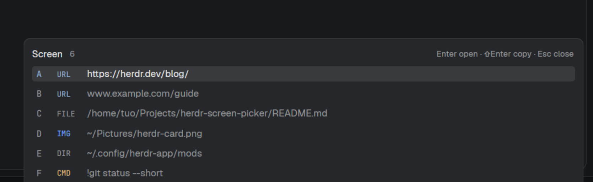

# herdr-screen-picker

One keystroke to reach anything already printed in a Herdr terminal: URLs,
files, folders, images and `!commands`, as letter badges in a small card.
Linux, macOS and Windows.



```
Screen 7                                  Enter open · ⇧Enter copy · Esc close
A  URL   https://herdr.dev/docs
B  URL   www.example.com/?q=hello+world
C  FILE  /tmp/notes.txt                   C:\Users\me\notes.txt
D  IMG   /tmp/shot.png                    C:/Users/me/shot.png
E  IMG   /tmp/link hints inline.png       quoted path with spaces
F  DIR   ~/.config/herdr-app/mods         ~ expanded
G  FILE  ./package.json                   resolved against the pane's cwd
H  CMD   !git status --short
```

This is a **herdr-app** mod (the desktop app), not herdr-tui. Developed against
herdr-app 0.1.13 / herdr-core 0.1.18 on Linux; the Windows and macOS paths are
chosen at run time from the app's own `window().platform`.

Shared as a `herdr-mod` repo, which is what puts a mod in the Herdr App gallery
(<https://herdr.dev/gallery/?type=mods>) under Community: `mods/screen-picker/`
is the mod, `RECIPE.md` the brief another agent can rebuild it from,
`preview.png` the picture and `keys.json` the key to merge. Nothing is
submitted or reviewed — the topic is the entry.

## Install

| Platform | Command |
| --- | --- |
| Linux, macOS | `./install.sh` (copy) or `./install.sh link` (edit the repo, app hot-reloads) |
| Windows | `.\install.ps1` (copy) or `.\install.ps1 -Link` (needs Developer Mode) |

Both write `mods/screen-picker` into `$HERDR_APP_HOME` (default
`~/.config/herdr-app`), back up `keys.json`, then point `ctrl-shift-o` at
`mod.open:screen-picker`. If that key was `pane.split:right` (the Herdr
default) they say so — the old action then has no key; bind it elsewhere or
restore the backup.

`install.sh` also takes `copy|link` and `keys|no-keys`; `install.ps1` takes
`-Link`, `-NoKeys`, `-AppHome`. To do it by hand, add one line:

```json
{ "global": { "ctrl-shift-o": "mod.open:screen-picker" } }
```

Verify:

```sh
herdr-app check ~/.config/herdr-app/mods/screen-picker
herdr-app status          # errors: [] while the card is open
herdr-app do mod.open --name screen-picker
```

## Keys

| Key | Does |
| --- | --- |
| `a`…`z` | open that row (`shift` copies it) |
| `Enter` / `Shift+Enter` | open / copy the selected row |
| `↑` `↓` `Tab` `Shift+Tab` | move |
| `Home` `End` | first / last |
| `Esc`, `Ctrl+C`, click outside | close |

Every key stays inside the card while it is open; nothing reaches the agent.

## What each kind does

| Kind | `Enter` | `Shift+Enter` |
| --- | --- | --- |
| `URL` | open in the browser (`www.` gets `https://`) | copy |
| `FILE` / `IMG` / `DIR` | the platform opener: `xdg-open`, `open`, `explorer.exe` | copy the absolute path |
| `PATH` | same opener, but the file could not be typed (see below) | copy |
| `CMD` | **copy only** | copy |

Commands are never typed anywhere by this mod: a `!command` on screen can only
leave as clipboard text, so no agent can receive text you did not paste yourself.

Openers run as a separate process and the card closes immediately. A failed
launch becomes an error toast; Windows' `explorer.exe` reports a non-zero exit
code even when it works, so there only a launch failure counts.

## How it finds things

One screen read (`hc read --json --lines 0 <terminal>`), then a pure scan
(`scan.js`, unit-tested):

- quoted strings that look like paths, URLs, then bare paths — in that order,
  so `https://host/a/b` is never re-read as `/a/b`;
- POSIX paths (`/x`, `~/x`, `./x`, `../x`), Windows drive paths (`C:\x`,
  `C:/x`) and UNC shares (`\\server\share\x`); quoted ones keep their spaces;
- paths are expanded (`~`), resolved against the focused pane's cwd, and then
  checked: non-existent ones are dropped, real ones become `FILE`, `IMG` (by
  extension) or `DIR`;
- a line's own `!command`, at the start of a line or after `Run: `;
- shell prompts (`~/proj ❯`, `C:\Users\me>`, `/tmp $ ls -la`) are skipped
  instead of badged as folders;
- duplicates share one row, rows keep screen order; relative paths use the
  pane's cwd.

### Why a row can say PATH

Herdr only lets a mod read inside the person's home folder, and `capabilities`
in a `mod.json` is not a thing the app honours. So:

- inside home: one `readdir` per folder types every row exactly;
- outside home: `test(1)` on Linux/macOS, `Test-Path` on Windows;
- if that check is unavailable (no PowerShell on a stripped Windows, say), the
  row is still shown as `PATH` — you can open it, it just isn't typed yet.

## Limits

- **Current screen only.** Herdr's scrollback is not exposed to mods; return to
  the bottom of the terminal first. Nothing is saved, uploaded or fetched.
- Bare filenames without a separator (`notes.md`) are ignored on purpose:
  badging every word ending in `.md` would be worse than missing some.
- OSC 8 named hyperlinks (link text that is not a URL) are not resolved.
- Relative paths use the pane's cwd, so a path printed by a program that
  `cd`'d elsewhere may not resolve.

## Development

```sh
npm test           # or: node --test tests/
```

`scan.js` is plain text handling with no imports beyond `path`, so the scanner
and the path arithmetic are tested on any platform without the app. The rest
(overlay, keys, probing) is checked by `herdr-app check` plus the manual steps
in the table above.

## Notes for other mod authors

Verified on herdr-app 0.1.13:

- In `mod.json`, overlay `width`/`height` are **fractions of the app window**
  (the shipped picker uses `"height": 0.8`), so `1`/`1` is a frameless
  full-window canvas. Give absolutely positioned cards explicit `.w()`/`.h()`;
  an auto-height card anchored with `right`/`bottom` can paint nothing.
- `exec()` resolves when the child's pipes close, so awaiting `xdg-open` keeps
  your overlay up until the viewer exits. Start it, dismiss, then handle the
  promise.
- `fs`, `fs/promises` and `os` are real modules, but every filesystem call is
  gated to read roots under the user's home and throws outside them.
  `"capabilities": { "fs": { "read": [...] } }` in `mod.json` is silently
  ignored — it belongs to gpui-shell plugins, not Herdr mods.
- `import { window } from "herdr"` is window *chrome*; it shadows the global
  `window`, which is the one with `viewport_size()`. Don't import it.

## License

MIT.
