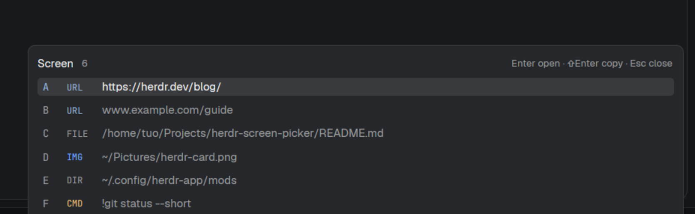

# Screen picker

A card in the corner of the Herdr window that lists everything already printed
on the focused terminal — URLs, files, folders, images and `!commands` — one
letter badge each. Pressing the letter opens the thing by its kind or copies
it, so one keystroke (`ctrl-shift-o`) reaches a link you can see but can't
easily select. It is a mod only: no layout file, no build step, no dependencies,
no processes of its own.



## What you see

A card 700px wide at the bottom-right of the window, 12px in from the right and
bottom edges, on the `popover` background with a 1px `border`, radius 8, 10px
padding. Top to bottom:

- **Header**, one row, 6px above the list. `Screen` at 12px semibold in
  `foreground`; the row count at 10.5px `muted`; a spacer; the hint on the
  right at 10.5px `muted`: `Enter open · ⇧Enter copy · Esc close`.
- **Rows**, 24px tall, 6px side padding, radius 4, one per item. Each row is
  three parts: the badge letter at 11px semibold in a fixed 18px slot (`accent`
  when selected, `muted` otherwise), a 30px kind tag at 9.5px in mono (`URL`
  `accent`, `CMD` `working`, `IMG` `done`, `FILE` `foreground`, `DIR` and
  `PATH` `muted`), then the value at 12px, middle-truncated past 92 characters.
  The selected row has the `selected` background; the others have none.
- **Status line**, 11.5px `muted`, only when there is something to say:
  `Reading this screen…`, the error, or
  `No links, files or commands on this screen.`

Six rows are 190px tall; the card grows and shrinks with the count and shows at
most 12 rows, scrolling with the selection so the selected row is always on
screen. Behind it the window is dimmed by the overlay, the terminal itself
untouched.

## How it behaves

`Enter` opens the selected row, `Shift+Enter` copies it, and a letter does the
same as Enter on that row. `↑` `↓` `Tab` `Shift+Tab` move, `Home`/`End` jump,
and `Esc`, `Ctrl+C` or a click outside close the card. Every key is stopped
inside the card: no keystroke reaches the agent underneath while it is open.
Rows are clickable; shift-click copies.

| Kind | `Enter` | `Shift+Enter` |
| --- | --- | --- |
| `URL` | the browser, `www.` given `https://` | copy |
| `FILE` / `IMG` / `DIR` | the platform opener (`xdg-open`, `open`, `explorer.exe`) | copy the absolute path |
| `PATH` | the same opener, for a row that could not be typed | copy |
| `CMD` | copy only, always | copy |

`!command` lines are copy-only on purpose: a command found on screen can only
leave as clipboard text, so nothing can be submitted by accident. The opener is
started as its own process and the card closes at once; a failed launch becomes
an error toast. Nothing is written anywhere, nothing reaches the network.

## Built from

`mods/screen-picker/` holds two files plus the pure scanner:

- `mod.json`: `{"place": "none", "title": "Screen picker", "overlay": {"kind":
  "window", "frame": "none", "at": {"x": 0, "y": 0}, "width": 1, "height": 1}}`.
  In an overlay block `width`/`height` are fractions of the app window, so `1`
  and `1` give a transparent canvas the size of the window and `frame: "none"`
  leaves the card to the mod.
- `main.js`: a `View` subclass. `init` captures `focused()`, in order `shown`,
  `terminal`, `agent`; keeps its `cwd` as the base for relative paths; reads
  `window().platform` (falling back to `os.platform()` where there is no window,
  as under `herdr-app check`); takes the focus handle; and starts one read,
  `hc(["read", "--json", "--lines", "0", terminal])` — the current screen only,
  never history, because reading history of a full-screen program can send it
  input. Rows are built once the read lands, and again on `Enter`.
- `scan.js`: plain functions, no filesystem. `candidates(text)` returns `{kind:
  "url" | "path" | "cmd", value, at}` in screen order. Quoted strings are read
  first (the only way a path may hold spaces, and they may hold a URL), then
  URLs, then bare paths, in that order, so `https://host/a/b` is never re-read
  as `/a/b`. Path forms: `/x`, `~/x`, `./x`, `../x`, `C:\x`, `C:/x`,
  `\\server\share\x`. A candidate is dropped when the line continues with a
  prompt glyph (`~/proj ❯`, `C:\Users\me>`, `/tmp $ ls -la` all read exactly
  like a path). A line's own `!command` is taken at the start of the line or
  after `Run: `.

Turning candidates into rows: expand `~`, resolve relative paths against the
pane's cwd, then type each path with one `readdir(dir, {withFileTypes: true})`
per directory — `DIR` or file, `IMG` by extension. A Herdr mod may only read
inside the person's home folder, so that covers exactly that; everything else is
settled outside by `exec("test", ["-e"…])` plus `["-d"…]` on Linux and macOS, or
one `powershell -Command …Test-Path -LiteralPath…` batch on Windows. A path
neither can settle is kept and shown as `PATH`. Absolute paths are deduped
(case-insensitively on Windows) and the `!command` lines are appended in place.

The card is a `v_flex()` with an explicit `.w(700)` and a height computed from
the row count and clamped to a maximum. Colours come from `theme()`; nothing is
hard-coded but the sizes.

Keys: the mod expects `global`: `ctrl-shift-o` → `mod.open:screen-picker` (the
`keys.json` next to this file). That is Herdr's default for
`pane.split:right`, so the split wants another key afterwards — `ctrl-shift-r`
suits it. It is one binding and it can be changed freely; nothing else in the
mod refers to it.

## Watch out

- An absolutely positioned child anchored with `right`/`bottom` paints nothing
  if its height is left to `auto`. Give it `.w()` and `.h()` explicitly.
- `exec()` resolves when the child's pipes close. Awaiting `xdg-open` keeps the
  overlay up until the viewer exits: start it, dismiss, then handle the promise.
- Every `fs`/`fs/promises` call is gated to read roots under the person's home
  and throws outside it. `"capabilities": {"fs": {"read": [...]}}` in `mod.json`
  is silently ignored — it belongs to gpui-shell plugins, not Herdr mods.
- `import { window } from "herdr"` is window chrome and shadows the global
  `window`, which is the one with `viewport_size()`. Don't import it.
- Current screen only: Herdr's scrollback is not exposed to mods, so a path
  scrolled away is not found. Bare filenames without a separator (`notes.md`)
  are ignored rather than guessed. OSC 8 named hyperlinks (link text that is not
  a URL) are not resolved. A path printed by a program that `cd`'d elsewhere may
  not resolve against the pane's cwd.
- Windows' `explorer.exe` exits non-zero even when it works, so only a launch
  failure counts there.

## Done when

```sh
npm test                                                  # 21 tests over scan.js
herdr-app check ~/.config/herdr-app/mods/screen-picker      # mod loads, no errors
```

Then in the app, show a screen holding a URL, an existing image path, a folder
and a `!command`, press the key, and check: six rows with the right kind tags;
a missing path produced no row; a prompt line produced none either; a badge
copies its value and closes; the image path opens the viewer; `Esc` closes
without touching the terminal.
